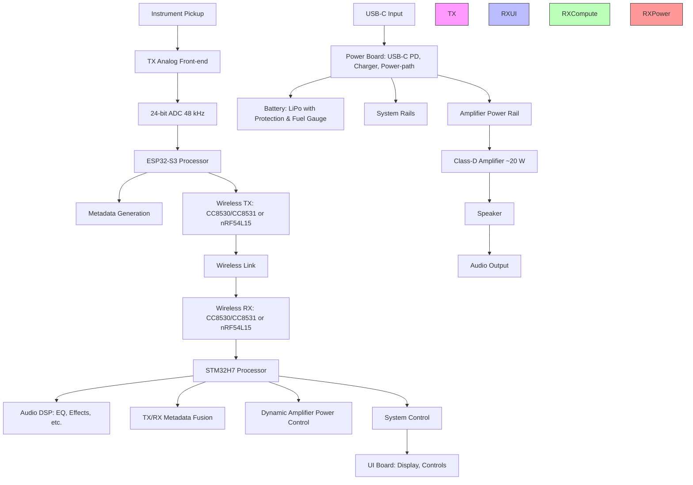

# System Architecture

## Overview
The Charlie Wireless Instrument System is partitioned into four PCBs:
1. **TX Instrument Module** (Transmitter)
2. **RX UI Board** (Layer 1)
3. **RX Compute/RF/Audio Board** (Layer 2)
4. **RX Power Board** (Layer 3)

This partitioning separates concerns: instrumentation and sensing (TX), user interaction (UI), core processing and wireless (Compute/RF/Audio), and power management (Power).

## TX Instrument Module
- **Function**: Captures instrument audio, processes sensor data (audio and IMU), generates metadata, and transmits audio and metadata wirelessly to the RX.
- **Key Components**:
  - Audio input: Instrument pickup and digital MEMS microphone
  - Audio acquisition: 24-bit ADC, 48 kHz minimum sample rate
  - Sensor: LSM6DS3TR-C IMU
  - Processor: ESP32-S3 (prototype) for edge processing
  - Wireless: CC8530/CC8531 (prototype) or nRF54L15 (production candidate)
  - Power: 3.7 V LiPo battery (~600 mAh scalable to ~1000 mAh) with USB-C charging, protection, and fuel gauge
- **Outputs**:
  - Uncompressed/lossless PCM audio (24-bit, 48 kHz, mono)
  - Metadata packet: Includes pitch, note, confidence, cents deviation, RMS/energy, attack, spectral features, MFCCs (where useful), IMU-derived data, microphone-derived acoustic features
- **Latency**: Designed for lowest practical packetization and buffering latency to achieve end-to-end latency target (<5 ms ideal, 10 ms realistic).

## RX UI Board (Layer 1)
- **Function**: Provides user interface for system control and status monitoring.
- **Key Components**:
  - 1.91-inch AMOLED display (240 × 536 resolution)
  - Touch/swipe interface
  - Rotary encoder with push
  - Status indicators (LEDs or similar)
  - Debug/programming interface (likely UART or JTAG)
  - FPC connection to Layer 2 (for low-speed control signals only)
- **Functions**:
  - Preset selection
  - Parameter adjustment (volume, effects, etc.)
  - Tuner
  - CharlieAI controls
  - Wireless status indication
  - Battery/power status indication
- **Constraints**: High-current signals (battery power, speaker power) must NOT be routed through the FPC to Layer 2.

## RX Compute/RF/Audio Board (Layer 2)
- **Function**: Central processing unit handling wireless reception, audio processing, sensor fusion, DSP, and system control.
- **Key Components**:
  - Primary MCU: STM32H7 (responsible for real-time audio processing, DSP, TX/RX metadata fusion, system control)
  - Optional secondary MCU: ESP32-S3 (connected directly to STM32H7, non-critical functions: Wi-Fi, Bluetooth/BLE, cloud, non-critical AI, experimental DSP/ML, data services; must NOT be in critical audio path unless proven necessary)
  - Wireless RX: Prototype CC8530/CC8531, production candidate nRF54L15 (proprietary 2.4 GHz)
  - Audio codec: To be selected (must support 24-bit, 48 kHz minimum, low-noise ADC, high-quality DAC)
  - Storage: 16 GB eMMC (for firmware, DSP profiles, amp models, cabinet IRs, audio samples, recordings, AI/ML models, user presets, logs, future training/analysis data)
- **Responsibilities**:
  - Receive 24-bit PCM audio and metadata from TX
  - Sequence number and timestamp/synchronization information
  - Independently analyze received audio: FFT, MFCC, pitch/F0, spectral features, energy/transient analysis
  - Fuse TX sensor intelligence with RX audio analysis
  - Real-time DSP: Parametric/graphic EQ, filtering, compression, limiting, gain staging, resonance compensation, amp modelling, cabinet modelling, convolution/speaker IR, volume-dependent EQ, speaker protection
  - Dynamic amplifier power control (based on power board telemetry)
  - System control and UI communication (via FPC to Layer 1)
- **Critical Constraint**: The board must operate correctly without the optional ESP32-S3 fitted.

## RX Power Board (Layer 3)
- **Function**: Manages all power input, conversion, distribution, battery charging, and monitoring.
- **Key Components**:
  - USB-C connector
  - USB-C PD negotiation controller
  - LiPo charger IC
  - Power-path management circuit
  - Battery protection IC
  - Battery fuel gauge IC
  - DC/DC converters (for system rails and amplifier power rail)
  - Current and voltage sensors (for input power, battery, system consumption)
  - Temperature sensors (for thermal monitoring)
- **Key Responsibilities**:
  - Detect actual available input power from USB-C source
  - Negotiate USB-C PD power contracts
  - Manage power path between USB-C, battery, and system loads
  - Provide system rails (e.g., 3.3V, 1.8V) and dedicated amplifier power rail
  - Monitor battery voltage, state of charge (SOC), current, temperature
  - Monitor amplifier power rail voltage and current
  - Provide telemetry to Layer 2 MCU for dynamic amplifier power limiting
  - Ensure graceful reduction of amplifier output on sudden input power reduction (via DSP gain control, not brownout/reboot)
  - Support simultaneous battery charging and system operation when power source permits
- **Power Architecture** (preferred):
  ```
  USB-C → USB-C PD/power detection → Power-path manager → System rails + battery charging → Amplifier power rail → ~20 W Class-D → Full-range speaker
  ```

## Signal Flows
### Audio Signal Flow
1. **TX**: Instrument pickup → Analog front-end → 24-bit ADC (48 kHz) → I2S to ESP32-S3 → Edge processing (optional metadata generation) → I2S to wireless transmitter → Wireless link
2. **Wireless Link**: Uncompressed PCM audio frames + metadata packets
3. **RX**: Wireless receiver → I2S to STM32H7 → Audio decoder (if needed) → 24-bit DAC → Amplifier → Speaker
   - Note: The audio path may include DSP processing on the STM32H7 before the DAC.

### Control and Data Flow
- **TX to RX**: Metadata packet (pitch, note, confidence, etc.) sent alongside audio or in separate packets.
- **RX to TX**: Potential for control messages (e.g., configuration) via wireless link (not explicitly specified in RFQ).
- **UI to Layer 2**: User commands via FPC (Layer 1 to Layer 2).
- **Layer 2 to UI**: Status information (wireless, battery, etc.) via FPC.
- **Power Board to Layer 2**: Telemetry (input power, battery status, temperature) via appropriate interface (likely SPI/I2C or UART).
- **Layer 2 to Power Board**: Amplifier power limit setting (via DAC or digital control).

### Power Flow
- **Input**: USB-C connector (5V nominal, up to 20V with PD)
- **Power Path**: Power management circuit directs power to system rails, battery charging, and amplifier power rail.
- **Battery**: Supplies system when USB-C not available or as supplement.
- **Amplifier**: Draws from dedicated amplifier power rail, limited by dynamic power control.

## Dependencies
- TX wireless module must be compatible with RX wireless module.
- STM32H7 must have sufficient processing power for real-time DSP and audio rates.
- Power board must provide adequate amplifier power rail capacity (~20 W peak).
- DSP algorithms must fit within STM32H7 processing budget and memory constraints.
- UI FPC must not carry high-current signals.

## Block Diagram

